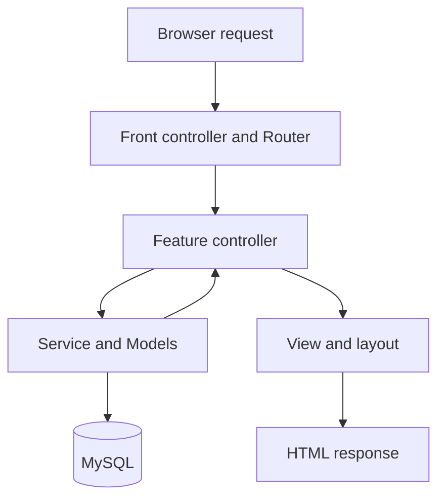

# OOP + MVC walkthrough

## Request flow

CSV reports are returned directly by ReportController. Successful POST requests redirect to a GET page. Database exceptions are logged and return a generic 500 response; validation failures return 422 with a readable message. Unauthorized report access returns 403. CSRF is checked before dispatching any POST action.

## MVC responsibilities

**Model:** `Models/Task.php` contains parameterized queries for task listing, allocation, locked reads, status updates and status history. It knows nothing about HTML or `$_POST`. Model objects receive a shared `Database` dependency.

**View:** `Views/tasks.php` renders prepared task data and forms. `Views/layout.php` supplies the shared header, navigation and messages. Views contain presentation conditionals and escaping, but no SQL, database connections or business mutations.

**Controller:** `Controllers/TaskController.php` reads validated request values and invokes `TaskService`. Its index action prepares pagination and presentation data. It redirects after successful writes.

**Service:** `Services/TaskService.php` verifies manager allocation permissions, employee ownership, version conflicts and completion/reopening rules. It coordinates task and history changes inside one transaction. `AuthService` coordinates account creation and persisted login throttling. `PerformanceService` provides independently testable scoring.

## OOP concepts used

| Concept | Concrete implementation |
|---|---|
| Classes and objects | Bootstrap creates User, Task, AuthService and controller objects |
| Encapsulation | Database's PDO connection is private; queries and transactions use public methods |
| Constructor dependency injection | TaskController receives Task, User, TaskService and Session |
| Composition | AuthService combines Database, User and LoginAttempt dependencies |
| Inheritance | Feature controllers extend the abstract Core Controller class |
| Shared behavior | The protected redirect method is inherited by controllers |
| Visibility | Private dependency properties and export methods; public controller actions |
| Namespaces and autoloading | `App\Models\Task` resolves to `app/Models/Task.php` |
| Type declarations | Typed parameters, return types and readonly injected properties |

Inheritance is deliberately limited to the controller base. Model and service classes use composition. No framework, ORM, or interface-based dependency container is required for this assignment.

## Example: complete a task

1. The employee submits `action=status`, task ID, version and status with a CSRF token.
2. Router validates the CSRF token and authenticated session.
3. TaskController validates request types and calls TaskService.
4. Database opens a transaction; Task locks the target row with `FOR UPDATE`.
5. TaskService checks ownership, current version and reopening permissions.
6. Task updates status and completion time, increments version, and inserts history.
7. Database commits; controller redirects to the task list.
8. On failure, the transaction wrapper rolls back before the error is displayed.

A repeated save of the same completed status does not overwrite completion time. A stale version returns a conflict message. Only managers may reopen a completed task.

## Route map

| Method | Query page or POST action | Handler |
|---|---|---|
| GET | `page=login`, `page=register` | AuthController form |
| GET | `page=dashboard` | DashboardController index |
| GET | `page=tasks` | TaskController index |
| GET | `page=updates` | DailyUpdateController index |
| GET | `page=reports` | ReportController index; managers only |
| GET | `page=reports&csv=1` | ReportController CSV export; managers only |
| POST | `action=login` | AuthController login |
| POST | `action=register` | AuthController register; always employee |
| POST | `action=logout` | AuthController logout |
| POST | `action=create_task` | TaskController store |
| POST | `action=status` | TaskController status |
| POST | `action=daily` | DailyUpdateController store |

## Compatibility and remaining limits

The existing MySQL schema, demo credentials, CSS and query-string URLs are retained. No migration or Composer installation is necessary. Serve only `public/`. Copy `config.example.php` to `config.php` on a fresh installation, or retain the previous configuration.

All managers still have organization-wide visibility. Registration remains open and does not verify email. Performance still reflects current task state rather than immutable historical snapshots. These product policies were not changed by the refactor.

## Verification

Run on a PHP/MySQL machine:

