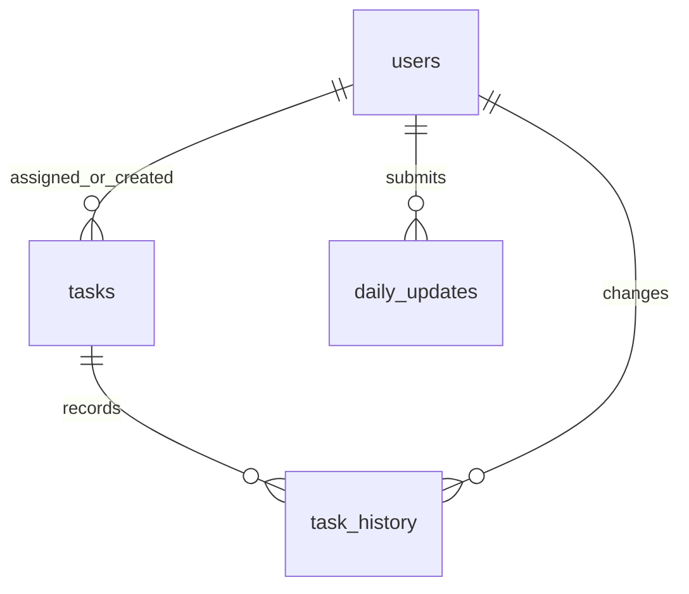

# Employee Daily Work Update & Performance Evaluation System

A framework-free PHP/MySQL technical assignment. Server-rendered, responsive UI; no JavaScript build step or Composer dependencies. Designed for PHP 8.2+ and MySQL 8.0+ with PDO MySQL. Runtime compatibility still needs verification in your PHP/MySQL environment.

## Included functionality

- Manager and employee authentication; CLI account provisioning.
- Managers allocate tasks with description, employee, deadline and priority.
- Employees view and update only their own tasks. Managers oversee all employees.
- Statuses: To do, In progress, Pending, Completed. Manager can reopen completed work.
- Derived overdue indicator, dashboard totals and status filters.
- One daily report per employee per day: accomplished, to do, pending and blockers. Today's report can be updated; prior days are read-only.
- Managers view daily reports and date-filtered employee performance; CSV export.
- Task status audit history in database and optimistic conflict checks.
- Lists paginated in groups of 50.

## Setup

1. Install PHP 8.2+ with `pdo_mysql`, and MySQL 8.0+. Use a MySQL account permitted to create the database and tables for installation.
2. From MySQL's administrative client, run the following. Replace the sample password before executing:

```sql
CREATE DATABASE employee_work CHARACTER SET utf8mb4 COLLATE utf8mb4_unicode_ci;
CREATE USER 'employee_app'@'127.0.0.1' IDENTIFIED BY 'replace-with-database-password';
GRANT SELECT, INSERT, UPDATE, DELETE ON employee_work.* TO 'employee_app'@'127.0.0.1';
```

3. Import schema with your administrative account:

```bash
mysql -u root -p employee_work < database/schema.sql
cp config.example.php config.php
```

Edit `config.php` to match your database host, credentials and timezone. The runtime account deliberately has no schema-changing permissions.

4. Create accounts from a Bash terminal; passwords are read from stdin so they do not appear in command arguments. Use 12–72 byte passwords.

```bash
read -r -s -p 'Manager password: ' manager_password
printf '%s' "$manager_password" | php bin/create-user.php 'Team Manager' manager@example.com manager
unset manager_password
read -r -s -p 'Employee password: ' employee_password
printf '%s' "$employee_password" | php bin/create-user.php 'Nital Panchal' nital@example.com employee
unset employee_password
```

For Windows/XAMPP, import `database/schema.sql` through phpMyAdmin, copy the configuration manually, and run `php bin/create-user.php "Team Manager" manager@example.com manager`. Type a password into standard input and end input with Ctrl+Z then Enter; this terminal entry may be visible. Do not use real production credentials in a shared terminal.

5. Start the development server from the project root:

```bash
php -S 127.0.0.1:8000 -t public
```

Visit http://127.0.0.1:8000. Only `public/` should be the web document root. Never serve the entire project directory. PHP's development server is for local testing.

## Workflow

1. Manager signs in and allocates a task to an employee.
2. Employee signs in and changes the task to In progress or Pending.
3. Employee submits today's work summary, upcoming tasks, pending work and blockers.
4. Employee completes the task; server records the completion timestamp.
5. Manager reviews overdue work, daily reports and performance. A manager can reopen a task if further work is needed.

Daily narrative updates do not change task statuses. Employees update statuses separately. A task becomes overdue after its deadline date ends in the configured timezone. No cron job is required.

## Performance logic

For a selected deadline range, consider only tasks with due dates before today. Let D be that count, C the tasks currently completed by the end of the selected period, and O those completed on or before their deadline and by the period end:

`score = 60 × C / D + 40 × O / D`

Example: 10 due tasks, 8 completed, 6 on time = 72/100. With no due tasks, show N/A. Dates due today or in the future are excluded so unfinished new assignments do not lower the score prematurely. All tasks have equal weight; priority is informational.

The result is a basic delivery indicator, not a complete assessment of employee ability. Task complexity, quality, approved leave, dependencies and manager feedback are not scored. Reports reflect current task status; a reopened task changes earlier reports. This is not an immutable historical snapshot system.

## Database design

| Table | Purpose | Relationships and constraints |
|---|---|---|
| users | Accounts and roles | Unique email; password hash |
| tasks | Allocation, status and deadline | Employee and assigning manager reference users |
| daily_updates | Daily narrative summary | Employee references users; unique employee/date |
| task_history | Status change trail | Task and actor foreign keys |
| login_attempts | Account-based login throttling | SHA-256 normalized email key |



Indexes support employee/status/deadline filtering and task history lookup. Foreign keys prevent orphan rows. Row locks plus version checks protect concurrent status edits. Task creation and history insertion are one transaction. Status changes and audit insertion are also one transaction. Task deletion is intentionally not exposed.

## Code organization

- `public/index.php`: request dispatch and HTML presentation.
- `public/style.css`: responsive UI.
- `app/bootstrap.php`: configuration, PDO, sessions and shared helpers.
- `app/actions.php`: mutation validation, authorization and transaction logic.
- `database/schema.sql`: normalized relational schema.
- `bin/create-user.php`: offline account provisioning.
- `tests/unit.php`: scoring, escaping and date validation checks.

For a larger application, split the presentation into templates and introduce controllers/repositories; this submission keeps dependencies minimal and core PHP logic easy to inspect.

## Security choices

Prepared queries, HTML output escaping, CSRF protection for every POST including login/logout, password hashing, session regeneration on sign-in, a 30-minute inactivity timeout, HttpOnly and SameSite cookies, CSP, server-side task ownership checks, validated enums/dates, and spreadsheet formula protection on CSV names. Five failed attempts block that email for 15 minutes, persisted in MySQL. This account-based throttle can be abused to lock another account; add edge/IP throttling before public deployment.

For production use HTTPS, set `secure_cookie` true, disable PHP `display_errors`, configure protected error logs, manage configuration outside version control, back up MySQL, and add password reset, account disabling and operational monitoring. The current role policy treats every manager as organization-wide; separate teams need manager-to-employee authorization rules.

## Validation status

The source was reviewed for ownership checks, score calculations, transaction rollback, date boundaries and output escaping. PHP and MySQL were unavailable in the authoring environment, and package installation failed. Consequently PHP linting, unit execution, browser rendering and live database integration have NOT been run. This project must pass the following checks on your machine before submission or deployment.

```bash
find app public bin tests -name '*.php' -exec php -l {} \;
php -l config.example.php
php tests/unit.php
```

### Integration acceptance checklist

1. Create one manager and two employees; verify valid and invalid sign-in and logout.
2. Allocate a task; confirm only its employee and managers can see it.
3. As the other employee, submit a status POST with that task ID: it must fail without changes.
4. Remove/alter a CSRF token: the mutation must fail.
5. Open a task in two browser tabs; save in one and then the other: the second must report a conflict.
6. Complete a task twice: completion time must stay unchanged. Employee reopening must fail; manager reopening must clear completion time and add history.
7. Save today's daily update twice: one row must exist. Employee must not read another employee's reports. Posted employee/date values must not override server-owned values.
8. Test a yesterday deadline and today's deadline: only yesterday's open task is overdue. To create historical fixtures, use your administrative MySQL client in a test database.
9. Verify 10 matured tasks, 8 completed, 6 on time yields 72. Check no tasks = N/A and tasks due today are excluded.
10. Verify report range boundaries, CSV output and employee access denial for reports/CSV.
11. Enter `<script>alert(1)</script>` in a title: it must display as text. Use an employee name starting `=1+1`: CSV must prefix an apostrophe.
12. Verify five failed sign-ins trigger lockout; wait 15 minutes or reset the test record in a test database.
13. Create 51 tasks and daily reports; verify Next/Previous pagination.

## Suggested next iterations

Manager quality ratings with feedback, task comments and attachments, team-specific access, leave-aware evaluations, immutable monthly reviews, reminder jobs, employee administration, and automated HTTP/MySQL integration tests.


| Role | Email | Demo password |
|---|---|---|
| Manager | admin@gmail.com | Manager@12345 |
| Employee | nital@gmail.com | Employee@12345 |