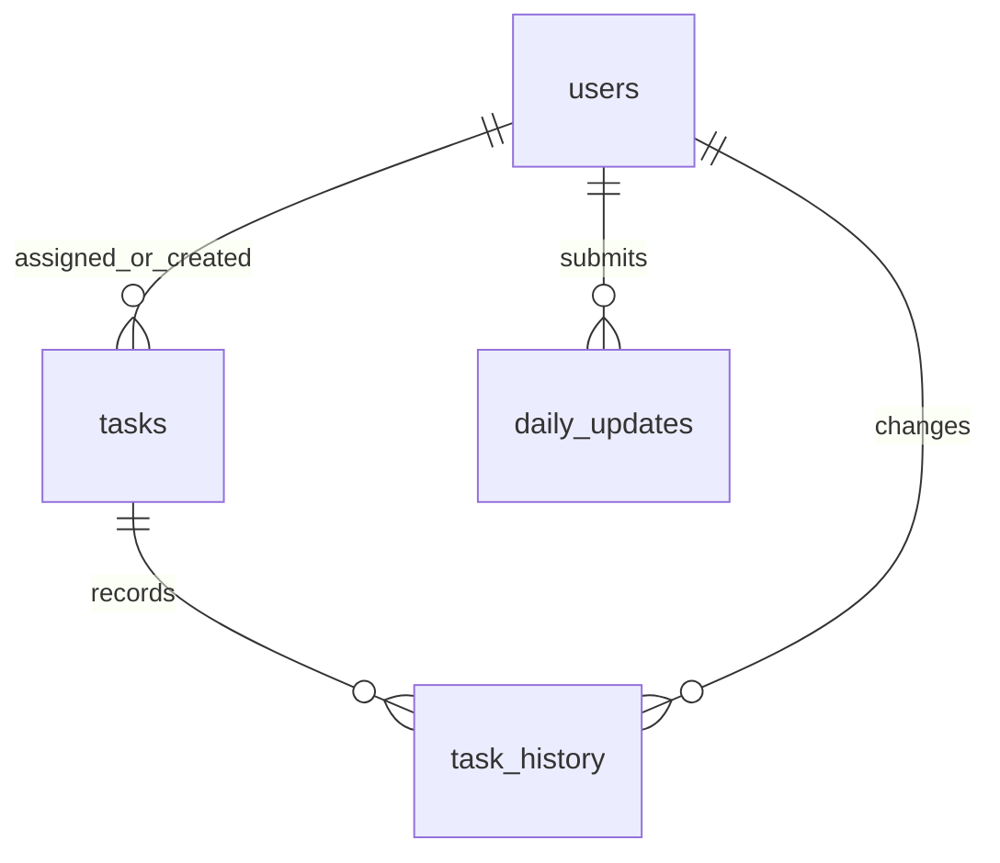

# Employee Daily Work Update & Performance Evaluation System

PHP/MySQL assignment. Server-rendered, responsive UI; no JavaScript build step or Composer dependencies. Designed for PHP 8.2+ and MySQL 8.0+ with PDO MySQL. Runtime compatibility still needs verification in your PHP/MySQL environment.

## Included functionality

- Managers allocate tasks with description, employee, deadline and priority.
- Employees view and update only their own tasks. Managers oversee all employees.
- Statuses: To do, In progress, Pending, Completed. Manager can reopen completed work.
- Derived overdue indicator, dashboard totals and status filters.
- One daily report per employee per day: accomplished, to do, pending and blockers. Today's report can be updated; prior days are read-only.
- Managers view daily reports and date-filtered employee performance; CSV export.
- Task status audit history in database and optimistic conflict checks.
- Lists paginated in groups of 50.

## Setup

1. Install PHP 8.2+ with `pdo_mysql`, and MySQL 8.0+. Use a MySQL account permitted to create the database and tables for installation.
2. From MySQL's administrative client, run the following. Replace the sample password before executing:


3. Import schema with your administrative account:

```bash
mysql -u root -p employee_work < database/schema.sql
mysql -u root -p employee_work < database/seed.sql
```

Edit `app/config.php` to match your database host, credentials and timezone. The runtime account deliberately has no schema-changing permissions.


4. Start the development server from the project root:

Visit http://127.0.0.1/employee-work-system/public/index.php. Only `public/` should be the web document root. Never serve the entire project directory. PHP's development server is for local testing.

## Workflow

1. Manager signs in and allocates a task to an employee.
2. Employee signs in and changes the task to In progress or Pending.
3. Employee submits today's work summary, upcoming tasks, pending work and blockers.
4. Employee completes the task; server records the completion timestamp.
5. Manager reviews overdue work, daily reports and performance. A manager can reopen a task if further work is needed.

Daily narrative updates do not change task statuses. Employees update statuses separately. A task becomes overdue after its deadline date ends in the configured timezone. No cron job is required.


## Database design

| Table | Purpose | Relationships and constraints |
|---|---|---|
| users | Accounts and roles | Unique email; password hash |
| tasks | Allocation, status and deadline | Employee and assigning manager reference users |
| daily_updates | Daily narrative summary | Employee references users; unique employee/date |
| task_history | Status change trail | Task and actor foreign keys |
| login_attempts | Account-based login throttling | SHA-256 normalized email key |





Indexes support employee/status/deadline filtering and task history lookup. Foreign keys prevent orphan rows. Row locks plus version checks protect concurrent status edits. Task creation and history insertion are one transaction. Status changes and audit insertion are also one transaction. Task deletion is intentionally not exposed.

## Code organization

- `public/index.php`: request dispatch and HTML presentation.
- `public/style.css`: responsive UI.
- `app/bootstrap.php`: configuration, PDO, sessions and shared helpers.
- `app/actions.php`: mutation validation, authorization and transaction logic.
- `database/schema.sql`: normalized relational schema.
- `bin/create-user.php`: offline account provisioning.
- `tests/unit.php`: scoring, escaping and date validation checks.

For a larger application, split the presentation into templates and introduce controllers/repositories; this submission keeps dependencies minimal and core PHP logic easy to inspect.


| Role | Email | Demo password |
|---|---|---|
| Manager | admin@gmail.com | Manager@12345 |
| Employee | nital@gmail.com | Employee@12345 |


# Manager side pages 
## Main Screen Manager Login page


## JOIN YOUR TEAM team registion page 


## Manager dashboard


## Manager create task


## Manager daily updates task


## Manager Performance task


# employee side pages 

## Main Screen employee Login page


## Main Screen employee dashboard page


## Main Screen employee Tasks page


## Main Screen employee daily updates page


