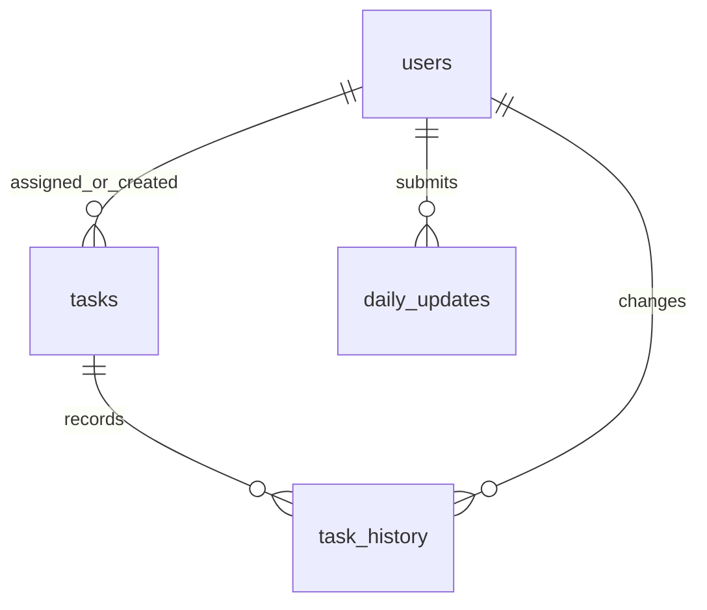

# Employee Daily Work Update & Performance Evaluation System

PHP/MySQL assignment using object-oriented programming and MVC. Server-rendered, responsive UI; no JavaScript build step or Composer dependencies. Designed for PHP 8.2+ and MySQL 8.0+ with PDO MySQL. Runtime compatibility still needs verification in your PHP/MySQL environment.

## Included functionality

- Managers allocate tasks with description, employee, deadline and priority.
- Employees view and update only their own tasks. Managers oversee all employees.
- Statuses: To do, In progress, Pending, Completed. Manager can reopen completed work.
- Derived overdue indicator, dashboard totals and status filters.
- One daily report per employee per day: accomplished, to do, pending and blockers. Today's report can be updated; prior days are read-only.
- Managers view daily reports and date-filtered employee performance; CSV export.
- Task status audit history in database and optimistic conflict checks.
- Lists paginated in groups of 50.

## Setup

1. Install PHP 8.2+ with `pdo_mysql`, and MySQL 8.0+. Use a MySQL account permitted to create the database and tables for installation.
2. From MySQL's administrative client, run the following. Replace the sample password before executing:


```sql
mysql -u root -p employee_work < database/schema.sql
mysql -u root -p employee_work < database/seed.sql
```

3. Import schema with your administrative account:


Edit `config.php` to match your database host, credentials and timezone. The runtime account deliberately has no schema-changing permissions.

4. The schema import automatically creates these demo accounts:

| Role | Email | Demo password |
|---|---|---|
| Manager | admin@gmail.com | Manager@12345 |
| Employee | nital@gmail.com | Employee@12345 |

Passwords are stored as salted bcrypt hashes, not plaintext. These credentials are for local demo testing only; remove or replace the demo accounts before public deployment.

If you already imported the earlier schema, import only the seed file; do not reimport the table definitions:

```bash
mysql -u root -p employee_work < database/seed.sql
```

In phpMyAdmin, select `employee_work`, choose **Import**, and upload `database/seed.sql`. On a fresh installation import `database/schema.sql` instead, which includes these same accounts. The seed leaves existing matching email addresses and passwords unchanged. If an account already existed, continue using its original password.

Optional additional accounts can still be created with `bin/create-user.php`; it reads a 12–72 byte password from standard input.

5. Start the development server from the project root:


Visit http://127.0.0.1/employee-work-system/public/index.php. Only `public/` should be the web document root. Never serve the entire project directory. PHP's development server is for local testing.

## Workflow

1. Manager signs in and allocates a task to an employee.
2. Employee signs in and changes the task to In progress or Pending.
3. Employee submits today's work summary, upcoming tasks, pending work and blockers.
4. Employee completes the task; server records the completion timestamp.
5. Manager reviews overdue work, daily reports and performance. A manager can reopen a task if further work is needed.

Daily narrative updates do not change task statuses. Employees update statuses separately. A task becomes overdue after its deadline date ends in the configured timezone. No cron job is required.


## Database design

| Table | Purpose | Relationships and constraints |
|---|---|---|
| users | Accounts and roles | Unique email; password hash |
| tasks | Allocation, status and deadline | Employee and assigning manager reference users |
| daily_updates | Daily narrative summary | Employee references users; unique employee/date |
| task_history | Status change trail | Task and actor foreign keys |
| login_attempts | Account-based login throttling | SHA-256 normalized email key |



Indexes support employee/status/deadline filtering and task history lookup. Foreign keys prevent orphan rows. Row locks plus version checks protect concurrent status edits. Task creation and history insertion are one transaction. Status changes and audit insertion are also one transaction. Task deletion is intentionally not exposed.

## OOP and MVC architecture

The application now uses namespaced classes with constructor dependency injection. `public/index.php` is a small front controller. `app/bootstrap.php` wires dependencies; `Core/Router.php` routes requests to dedicated controllers. Models own SQL and persistence, services own multi-step business rules, and views render data supplied by controllers.

| Layer | Directory | Responsibilities |
|---|---|---|
| Front controller | `public/index.php` | Exception handling, application boot and dispatch |
| Core | `app/Core/` | Routing, PDO connection, transaction wrapper, request validation, session/CSRF and rendering |
| Controllers | `app/Controllers/` | Authentication, dashboard, task, daily update and report request handling |
| Models | `app/Models/` | User, Task, DailyUpdate, Report and LoginAttempt database operations |
| Services | `app/Services/` | Authentication, allocation/status workflow and performance calculations |
| Views | `app/Views/` | Shared layout and six page templates; no SQL queries |
| Bootstrap | `app/bootstrap.php` | Create shared dependencies and inject them into classes |
| Autoloading | `app/autoload.php` | Map `App` namespaces to files without Composer |
| Helpers | `app/helpers.php` | HTML escaping and CSRF hidden field only |
| CLI | `bin/create-user.php` | Provision manager or employee accounts through the User model |
| Database | `database/` | Existing schema and demo account seed |
| Tests | `tests/unit.php` | Pure service, validator and request checks; no database/config required |

See `ARCHITECTURE.md` for class responsibilities, OOP examples and request flow. Existing URLs, demo accounts and database tables remain compatible. For an existing installation, keep your `config.php` and database, replace application source files, and remove obsolete `app/actions.php`. Do not reimport schema or overwrite configuration. 

# Manager side pages 
## Main Screen Manager Login page


## JOIN YOUR TEAM team registion page 


## Manager dashboard


## Manager create task


## Manager daily updates task


## Manager Performance task


# employee side pages 

## Main Screen employee Login page


## Main Screen employee dashboard page


## Main Screen employee Tasks page


## Main Screen employee daily updates page


